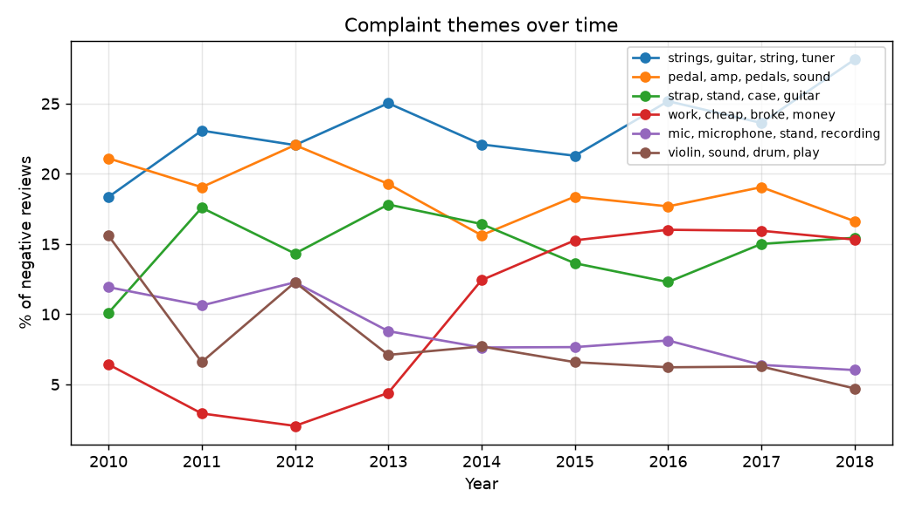
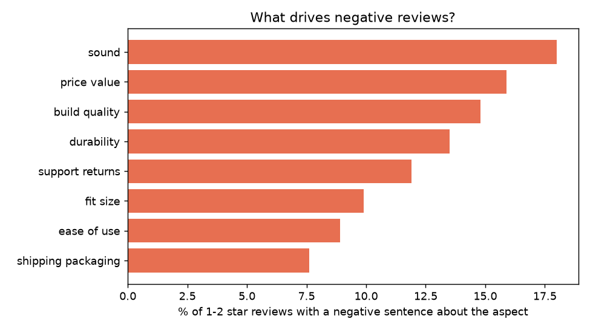
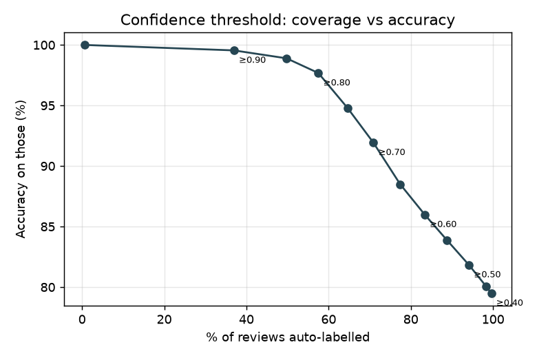

# Review Insights: sentiment, complaint topics and aspect drivers in 185k Amazon reviews

What do customers of musical-instrument products complain about, and why? This project goes from raw reviews to three
layers of answer:

1. **Sentiment** (negative / neutral / positive): 7 models compared on the same held-out *future* reviews, from TF-IDF to a fine-tuned transformer.
2. **Complaint topics**: what 1–2★ reviews are about (LDA vs BERTopic), and how that changed over time.
3. **Aspect drivers**: which product aspects (sound, durability, price, …) are mentioned negatively, sentence by sentence.

A Streamlit app ties it together: paste a review and get its sentiment plus per-sentence aspect sentiment.

## Data and evaluation design

- **Amazon Reviews 2018, Musical Instruments 5-core** (McAuley lab, UCSD): 231,392 reviews → **185,621** after cleaning
  and removing duplicates (the 5-core file repeats the same review across product variants, which would leak text
  between train and test).
- Labels from stars: 1–2 → negative, 3 → neutral, 4–5 → positive (85% positive, 7% neutral, 7% negative).
- **Time-based split**: train on reviews before 2017 (142,684), test on 2017–2018 (42,937). This mimics deployment:
  the model always predicts the future. All models are scored on the **same fixed sample of 6,000 test reviews**.
- **Only the review body is used.** About 30k review *titles* are auto-generated ("Five Stars", "One Star"), so they would
  give the label away.
- Metric: **macro-F1**, because with 85% positives accuracy rewards ignoring the minority classes.

## Results: sentiment

| Model | Train data | Macro-F1 | F1 neg | F1 neutral | F1 pos | Accuracy |
|---|---|---:|---:|---:|---:|---:|
| **TF-IDF (1–3 grams, negations kept) + LR** | 142k reviews | **0.668** | 0.659 | 0.404 | 0.940 | 0.871 |
| DistilBERT fine-tuned (1 epoch, CPU) | 6k balanced | 0.618 | 0.634 | 0.328 | 0.891 | 0.793 |
| Twitter-RoBERTa sentiment, zero-shot | none | 0.594 | 0.632 | 0.231 | 0.918 | 0.827 |
| Original project's recipe (stopwords removed) | 142k reviews | 0.587 | 0.562 | 0.303 | 0.895 | 0.795 |
| TF-IDF + LR, **same 6k sample as DistilBERT** | 6k balanced | 0.583 | 0.563 | 0.315 | 0.871 | 0.766 |
| MiniLM sentence embeddings + LR | 35k balanced | 0.566 | 0.536 | 0.279 | 0.884 | 0.781 |

What the table says:

- **Cleaning can destroy the signal.** The original pipeline removed NLTK stopwords, which include *not*, *no* and
  *don't*: `"This is not good at all"` becomes `"good"`. Keeping negations and `!`/`?`, adding trigrams and sublinear tf
  lifts macro-F1 from **0.587 to 0.668** with the same model family. "not" is the single strongest negative feature.
- **On equal data, the transformer wins.** Trained on the identical 6k balanced sample, DistilBERT beats TF-IDF by
  3.5 points (0.618 vs 0.583). TF-IDF on all 142k reviews is still best, because a CPU budget limited fine-tuning to 6k
  reviews and 1 epoch. With a GPU, fine-tuning on the full set is the obvious next step.
- **Zero-shot is a strong baseline for free.** A general sentiment model never trained on this data almost matches the
  original project's trained pipeline, but it struggles with "neutral" (F1 0.23): 3★ means "mixed" here, which a tweet
  model doesn't see that way.
- **Neutral is the hard class for every model** (best F1 0.40). Many 3★ reviews are positive text with one complaint.
  That's label noise, not just model error (see error analysis).
- **Prior correction is a trade-off, not a fix.** Re-weighting balanced-trained probabilities to the real 85% positive
  rate raises accuracy (DistilBERT 0.79 → 0.89) but lowers macro-F1 (0.618 → 0.603), so the headline uses raw predictions.

## Results: complaint topics (13,165 negative reviews)

| | LDA (12 topics) | BERTopic (14 topics) |
|---|---:|---:|
| Topic diversity | 0.64 | **0.74** |
| NPMI coherence | **0.153** | 0.131 |
| Outliers | 0% | 27% |

BERTopic (MiniLM embeddings → UMAP → HDBSCAN → c-TF-IDF) gives more distinct topics; LDA's are slightly more coherent
by NPMI. The bigger lesson is *what* the clusters are: mostly **product types** (strings/tuners 17%, pedals/amps 13%,
straps/stands/cases 11%, mics 6%), plus one cross-cutting theme, **"cheap / broke / waste of money" (9.5%)**. That theme
grew from ~3% of complaints in 2012 to ~15% from 2015 on.



Topic models group complaints by *what product* they're about. To learn *why* customers are unhappy, you need aspects.

## Results: aspect drivers (14,000 reviews, 2012–2018 → 27,184 aspect mentions)

Each sentence is tagged with product aspects (a lexicon of specific terms) and classified by the fine-tuned DistilBERT.



| Aspect | Mentions per 100 reviews | % of mentions negative | % of 1–2★ reviews with a negative sentence on it |
|---|---:|---:|---:|
| sound | 54 | 13% | **18%** |
| price / value | 37 | 15% | 16% |
| build quality | 32 | 11% | 15% |
| **durability** | 6 | **55%** | 14% |
| **support / returns** | 6 | **41%** | 12% |
| fit / size | 23 | 15% | 10% |
| ease of use | 28 | 12% | 9% |
| shipping / packaging | 10 | 23% | 8% |

Two different kinds of problem:
- **Volume drivers.** Sound, price and build quality come up constantly and are mostly praised, but because they come up so often
  they still appear in 15–18% of 1–2★ reviews.
- **Red flags.** Durability and support are rarely mentioned, but when they are, it's negative 55% / 41% of the time.
  A sentence about something breaking or a return is a strong churn/complaint signal. This lines up with the "cheap /
  broke / waste of money" topic growing from 3% to 15% of complaints.

## Error analysis: when the model and the stars disagree

The most confident "mistakes" are often the *label* that's wrong, not the model:

| Stars | Review (excerpt) | Model says |
|---|---|---|
| 5★ | "waste of money, fake reviews" | negative |
| 1★ | "Nice wall hanger." | positive (sarcasm) |
| 1★ | "Sounds great if you're tone deaf." | positive (sarcasm) |

Sarcasm and mis-clicked stars cap the achievable score. A confidence threshold makes the model usable in practice:
**auto-label predictions with confidence ≥ 0.80 (57% of reviews) at 97.7% accuracy**, and send the rest to a human or a
slower model.



## Project structure

```
src/reviewnlp/
  data.py                 load, clean (light), dedupe, label, time split, shared eval sample
  legacy_clean.py         the original project's cleaning (kept to reproduce its baseline)
  baselines.py            TF-IDF + LR: legacy vs improved (C tuned on a 2016 validation year) vs same-budget
  transformers_models.py  MiniLM embeddings + LR, zero-shot RoBERTa, DistilBERT fine-tuning (HF Trainer)
  topics.py               LDA vs BERTopic, NPMI coherence, topics over time
  aspects.py              sentence split → aspect lexicon → sentence sentiment (DistilBERT)
  error_analysis.py       confident disagreements with stars, coverage-vs-accuracy curve
  evaluate.py             metrics, confusion matrices, MLflow logging, comparison table
app/app.py                Streamlit app
run_pipeline.py           python run_pipeline.py [data baselines transformers topics aspects errors]
tests/                    7 unit tests (cleaning, labels, aspects, prior correction, sampling, topic metrics)
```

## Run it

```bash
python -m venv .venv && .venv\Scripts\activate        # macOS/Linux: source .venv/bin/activate
pip install -r requirements.txt
python -m nltk.downloader stopwords punkt punkt_tab
# data: Musical_Instruments_5.json.gz from https://cseweb.ucsd.edu/~jmcauley/datasets/amazon_v2/ → data/raw/
python run_pipeline.py            # ~1.5 h on a laptop CPU (fine-tuning + zero-shot dominate)
pytest -q
streamlit run app/app.py
mlflow ui --backend-store-uri sqlite:///mlflow.db     # every run's params, metrics and confusion matrix
```

## Limitations and next steps

- Fine-tune on the full training set with a GPU, plus 2–3 epochs and early stopping on a validation year.
- The aspect lexicon is hand-built (high precision, misses paraphrases). Next: zero-shot NLI or an LLM to tag aspects.
- Stars are a noisy label for text sentiment. A few hundred hand-labelled sentences would give a cleaner test set.

## Acknowledgements

Started from [saketh97/Sentiment-topic-insights-for-Amazon-reviews](https://github.com/saketh97/Sentiment-topic-insights-for-Amazon-reviews)
(MIT): TF-IDF + LR baseline, sklearn LDA, MLflow and a basic Streamlit app. This version fixes the evaluation (3-class
macro-F1 instead of a binary score on 3-class labels, time-based split, duplicate removal, title leakage), keeps negations
in cleaning, and adds the transformer models, BERTopic, aspect-based sentiment, error analysis, tests and a new app.
Data: Jianmo Ni, Jiacheng Li, Julian McAuley, *Justifying recommendations using distantly-labeled reviews and
fine-grained aspects*, EMNLP 2019.
